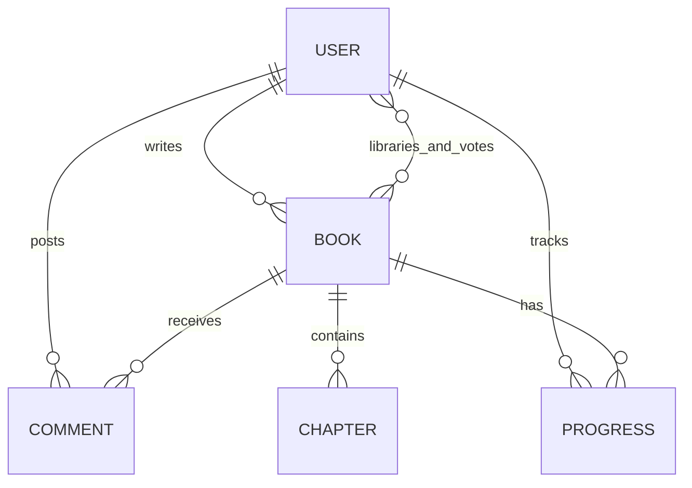

# Storyhaven — MERN web novel platform

A mini-project for readers and writers. React and Vite provide the interface; Node.js and Express provide the API; MongoDB and Mongoose persist data. The interface supports Home, Explore, Library, Publish and profiles. Users register with an email address and password and sign in with username and password. This is email/password registration, not Google OAuth or Gmail ownership verification.

## Requirements

- Node.js 20 or newer and npm
- MongoDB Community Server running locally, or a MongoDB Atlas connection string

## Setup

1. Extract the project. Open a terminal in the `novel-platform` folder.
2. Run `npm run install:all` to install server and client dependencies.
3. Copy `server/.env.example` to `server/.env`. Set `MONGO_URI` to your MongoDB connection string and `JWT_SECRET` to a long, unique random secret of at least 24 characters. Never commit `.env`.
4. Start MongoDB. Run `npm run dev:server` in one terminal.
5. Run `npm run dev:client` in another terminal. Open http://localhost:5173.
6. Create an account, open Publish, add a title, description, genre and complete chapter, and publish it. Search in Explore, add it to Library and open it to read. You can also save a draft and later edit or delete it.

`npm run build` builds the React frontend. Vite proxies `/api` to port 5000 during development. Configure a reverse proxy or equivalent for deployment; this project does not include production hosting or cloud storage. Profile and cover images are stored as restricted-size data URLs in MongoDB, which is suitable for a small demonstration but should be replaced with dedicated object storage for a larger deployment. Set `CLIENT_ORIGIN` to your frontend origin. Use HTTPS, stronger production security controls, backup and monitoring before public deployment.

## Main features

- Books: create, list, search by title or author, filter by genre, sort, edit and delete with confirmation. Published books require at least one complete chapter; drafts are private to their author.
- Reader: chapter selection, text size, saved chapter and reading position per user, one toggleable vote per user/book, sharing, and chapter comments with edit/delete ownership checks.
- Profile: picture, bio, public reading list and published works. Library add/remove persists per account.
- Security basics: password hashing, signed tokens, protected routes, basic auth rate limiting, ownership checks, input limits and validation. Tokens are stored in browser localStorage for this project; a production system should use an appropriate hardened session design. Email addresses are not verified; password reset is not implemented.
- The reader uses a scrollable chapter view, so it restores the last scroll position rather than a fixed page number. Font size is saved in the current browser.

## Data model / ERD

- User: username and email unique, password hash, bio, photo, book references and per-book chapter/scroll progress.
- Book: author reference, title, description, genre, cover, draft/published status, embedded chapters with IDs and voter references.
- Comment: book, chapter and author references, text and timestamps. Deleting a book deletes its comments and library/progress references. Removing a chapter deletes its comments.

## Suggested demonstration (under five minutes)

1. Show registration and sign-in; add a profile photo and bio.
2. Create a book, save a draft, edit and publish a chapter.
3. Search and filter in Explore; add the book to Library.
4. Open a chapter, change font size, vote and add/edit/delete a comment. Scroll, leave and reopen to show progress.
5. Edit and delete a book, then verify it disappears. Show MongoDB collections and explain the relationships.

Take your own screenshots for the report and add the project to your own GitHub repository. Read and understand the code, document your own work and check your course rules on AI-generated material. The evaluation rubric asks for a report of at most 10 pages and a demonstration video of at most 5 minutes, with camera on.
